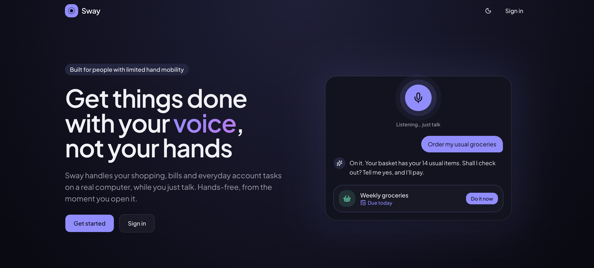

# Sway

**A voice-first assistant that helps people with limited hand mobility handle shopping and everyday account tasks, with AI calls routed through Mubit.**



Using a mouse or keyboard can make a simple weekly shop difficult. Sway lets a person describe what they need, then operates a separate cloud desktop on their behalf. The person can watch, take over when needed, and decide whether consequential actions should proceed.

## The idea

Say **“Order the usual.”** Sway uses a saved routine to understand what “the usual” means for that person, opens a browser on its own desktop, and works through the website by looking at the screen, clicking, scrolling, and typing.

Voice is the primary interaction: Sway attempts to start listening when the assistant opens, sends a request after the person stops speaking, reads replies aloud, and resumes listening. This depends on browser support and microphone permission; text input remains available.

The aim is to reduce the physical effort of repetitive online chores while keeping the person involved. A routine captures the person's instructions and preferred phrases; it does not authorize an unattended purchase.

### Example: weekly groceries

1. The person saves a grocery routine with a phrase such as “the usual.”
2. They say “Order the usual.”
3. Sway starts or resumes their separate desktop and navigates to the shopping website.
4. It works through the task and asks before a purchase or other consequential action.
5. If sign-in or verification is required, it explains what is needed and asks the person to complete it in the live desktop view.
6. The person replies when ready, and Sway can continue.

The live walkthrough uses Uber Eats: it clears the cookie notice, enters a public demonstration address, selects an address suggestion, opens Grocery, and stops at sign-in. It does not place a real order.

## Mubit’s role

Mubit is the gateway behind Sway's model requests. The server uses provider SDKs configured with Mubit endpoints and a Mubit API key. Chat and computer use share the configured provider and model.

The implementation supports Anthropic, OpenAI, Gemini, and OpenRouter routes. Anthropic and Gemini use their native computer-use tools; the OpenAI and OpenRouter paths expose desktop actions through function calling. Computer use requires a model and gateway configuration that support the relevant tools and image input.

### Where we want to take it

Recurring tasks repeat many of the same steps. Our next direction is to turn a person's corrections into task-specific model updates through Mubit, so future attempts at those chores become more reliable.

The earlier Proxy Co-op concept extends this with a personal model layer for individual preferences and a community layer for reusable website-navigation corrections. Its proposed privacy boundary is to share navigation knowledge without sharing personal data.

**Model adaptation, correction-to-training pipelines, shared community adapters, adapter stacking, and adapter export are future work.** This repository currently routes inference through Mubit and supplies saved routines as prompt context; it does not train or update model weights.

## Current implementation

| Area | What is implemented |
| --- | --- |
| Voice interaction | Browser speech recognition, spoken replies, automatic listening and sending preferences, and text input. |
| Assistant | Streamed replies and computer-action events, with conversation history loaded on the server. |
| Computer use | Screenshot-based interaction with a Linux desktop in Vercel Sandbox, plus an embedded noVNC view for manual control. |
| Saved routines | Instructions, personal trigger phrases, due dates, recurring schedules, and upcoming-task cards. Routines inform requests; they are not background jobs that execute themselves. |
| Conversations | Stored chat history with search, rename, and delete controls. Search is currently through the command palette; voice-driven history search remains a product direction. |
| Accounts | Email/password registration and login, hashed passwords, signed session cookies, and optional invite-only registration. |
| Walkthrough | A scripted live-site sequence with a simulated fallback for demonstrating the interaction. |

## User control and data

The computer-use prompt instructs the assistant to ask for explicit confirmation before purchases, payments, form submissions, messages, deletions, or accepting terms. It also instructs it to hand over passwords, payment details, one-time codes, CAPTCHAs, and verification to the person. These are model instructions, not a separate deterministic approval system.

The desktop runs separately from the person's device. Each account gets a named sandbox; the implementation preserves its disk when stopped so browser logins and files can survive between sessions. Hiding the desktop panel does not stop the sandbox; use its stop control when finished.

MongoDB stores accounts, conversations, and routines. Conversation content and routine context are sent through Mubit to the selected provider, and desktop screenshots are supplied to the computer-use model. “Separate desktop” does not mean local-only processing.

## Run locally

You need a Node.js version compatible with Next.js 16, npm, a reachable MongoDB instance, and a Mubit API key with inference permission. Desktop operation additionally requires Vercel Sandbox access and a desktop snapshot.

```bash
npm ci
cp .env.example .env.local
openssl rand -base64 48
```

Edit `.env.local`: set `MONGODB_URI`, paste the generated value into `SESSION_SECRET` (at least 32 characters), and set `MUBIT_API_KEY`. Keep credentials out of version control.

```bash
npm run dev
```

Open [localhost:3000](http://localhost:3000), create an account, and enter the assistant. With `COMPUTER_USE_ENABLED=false`, the app provides chat without operating websites.

### Configuration

See [`.env.example`](.env.example) for the full template.

| Variable | Purpose |
| --- | --- |
| `MONGODB_URI` | Database connection string. The example uses a local `nightshift` database. |
| `SESSION_SECRET` | Secret for signed sessions and desktop viewer credentials; minimum 32 characters. |
| `MUBIT_API_KEY` | Mubit key used for model requests. |
| `MUBIT_PROVIDER` | `anthropic` (default), `openai`, `gemini`, or `openrouter`. |
| `MUBIT_ANTHROPIC_MODEL`, `MUBIT_OPENAI_MODEL`, `MUBIT_GEMINI_MODEL`, `MUBIT_OPENROUTER_MODEL` | Optional provider-specific model overrides. Set the OpenRouter model explicitly to one your key serves. |
| `MUBIT_OPENROUTER_PROVIDER` | Optional OpenRouter provider restriction, such as `google-vertex`. |
| `SIGNUP_INVITE_ONLY`, `SIGNUP_INVITE_CODE` | Optional registration restriction. |
| `COMPUTER_USE_ENABLED` | Set to `true` to enable desktop tools. Defaults to off in the example. |
| `SANDBOX_SNAPSHOT_ID` | Desktop image created by the snapshot script. |
| `VERCEL_TOKEN`, `VERCEL_TEAM_ID`, `VERCEL_PROJECT_ID` | Explicit Sandbox credentials; alternatively use Vercel OIDC credentials. |

### Enable the desktop

1. Configure Vercel credentials using `vercel link` and `vercel env pull`, or set all three `VERCEL_*` variables above in `.env.local`.
2. Run `npm run desktop:snapshot`. This provisions a cloud sandbox, installs the Linux desktop and Chrome, and saves a reusable snapshot.
3. Copy the printed `SANDBOX_SNAPSHOT_ID` into `.env.local` and set `COMPUTER_USE_ENABLED=true`.
4. Restart the app and open the desktop from the assistant, or request a task that needs it.

Snapshot creation and active desktops consume Vercel resources. If the gateway rejects native computer-use tools with `starter_credit_tools`, the app reports that a personal provider key must be added in the Mubit console.

## Guided walkthrough

While signed in, open the command palette with **⌘K / Ctrl+K** and type `/demo`.

The walkthrough attempts a fixed sequence on the real Uber Eats website when the desktop is available. Its live actions and dialogue are scripted; this sequence does not invoke the AI agent. It uses “Times Square, New York” as the demonstration address and stops at login. If the live desktop cannot start, a simulated shopping flow demonstrates the intended experience. Simulated order confirmations and prescription refills are not real transactions.

Normal assistant requests use the Mubit-backed model path independently of this walkthrough.

## Architecture

The browser handles voice, chat, routines, and the live desktop view. Next.js server routes and actions authenticate requests, retrieve context from MongoDB, and call the selected model through Mubit. For computer tasks, a server-side agent exchanges screenshots and actions with a Linux desktop running Chrome in Vercel Sandbox.

Built with Next.js 16 App Router, React 19, TypeScript, Tailwind CSS 4, Mongoose, browser speech APIs, provider SDKs, and Vercel Sandbox.

| Path | Responsibility |
| --- | --- |
| `src/app/api/assistant/route.ts` | Authenticated assistant requests, history, streaming, and persistence. |
| `src/lib/ai.ts` | Mubit endpoints, provider configuration, and chat streaming. |
| `src/lib/computer/` | Desktop lifecycle, action validation, provider agents, and instructions. |
| `src/hooks/use-voice-mode.ts` | Listening, automatic sending, and spoken-reply coordination. |
| `src/lib/routines.ts` | Routine retrieval and personal context supplied to the assistant. |
| `src/lib/showcase/` | Scripted demonstration and live-site steps. |
| `scripts/desktop/` | Desktop image setup and launch scripts. |

## Development commands

```bash
npm run lint          # ESLint
npm run test:actions  # Action planning, OpenAI agent, and showcase checks
npm run build         # Production build
npm start             # Serve the production build
```

The focused checks do not establish that the assistant can complete arbitrary live-site tasks. Real websites, browser speech permissions, model capabilities, and provider access affect the end-to-end experience.
